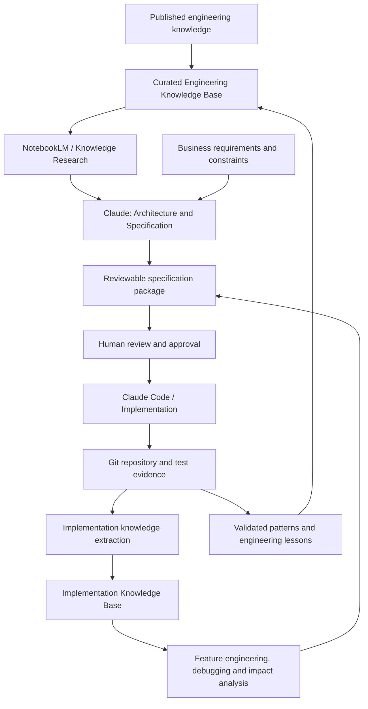

# SpecBook-Agent

**Knowledge-grounded, specification-driven engineering for large software systems.**

SpecBook-Agent explores a disciplined way to use AI coding agents to design, build, understand, and evolve complex software systems.

The central idea is simple:

> Don't ask an AI coding agent to invent an entire system from a prompt. Give it a curated body of engineering knowledge, make it turn requirements into reviewable specifications, implement against those specifications, and then make the resulting codebase a second source of engineering knowledge.

SpecBook-Agent brings together two complementary knowledge environments:

1. **Engineering knowledge** — published documentation, open-source implementation patterns, architecture practices, programming knowledge, and reusable engineering skills.
2. **Implementation knowledge** — the actual system: its source code, interfaces, data models, tests, architecture decisions, dependencies, operational configuration, and known limitations.

The goal is to connect these environments through a controlled engineering lifecycle rather than treating code generation as a one-off activity.

> **Project status:** Early-stage concept and open-source engineering experiment. The architecture and workflow described here are the intended direction, not a claim that all capabilities are already implemented.

---

## Why SpecBook-Agent?

AI coding tools have made it much easier to generate code. Building and maintaining a large system, however, involves more than producing functions and files.

An engineering team must make consistent decisions across requirements, architecture, data, APIs, security, testing, deployment, and operations. Those decisions must remain coherent as the system changes.

A coding agent working from a narrow prompt may miss established patterns, misunderstand project constraints, or make changes without understanding their wider impact. A large collection of documentation alone does not solve this: knowledge must be selected, applied, verified, and kept aligned with the implementation.

SpecBook-Agent investigates a workflow in which:

- Engineering decisions are grounded in curated, attributable sources.
- Requirements are translated into explicit and reviewable specifications.
- Implementation follows approved specifications and project conventions.
- The codebase is documented as an evolving body of implementation knowledge.
- New features and fixes are assessed against the system that actually exists.
- Lessons from validated implementations can improve future engineering work.

The intended outcome is **more consistent, explainable, and maintainable AI-assisted engineering**.

## The dual-knowledge model

### 1. Engineering Knowledge Base

The first knowledge environment captures how software systems can be engineered.

It can include:

- Software architecture patterns and design principles.
- Official documentation for languages, frameworks, and infrastructure.
- Open-source project documentation and selected implementation examples.
- Database, API, integration, and distributed-systems patterns.
- Security, testing, observability, and deployment practices.
- Reusable engineering playbooks and agent skills.
- Source references, versions, licenses, and applicability notes.

This knowledge should be curated rather than indiscriminately accumulated. A source is useful only when its origin, relevance, version, and limitations can be understood.

NotebookLM can provide a convenient source-grounded research and synthesis interface over selected material. The underlying knowledge should remain organized in portable, version-controlled files wherever possible.

### 2. Implementation Knowledge Base

The second knowledge environment describes what has actually been built.

It is derived from the project repository and its engineering evidence, including:

- Source code and module boundaries.
- Architecture and component relationships.
- Database schemas and migrations.
- API contracts, events, and integrations.
- Dependency manifests and configuration.
- Tests, test results, and quality reports.
- Architecture decision records.
- Deployment and operational documentation.
- Known defects, limitations, and technical debt.

This knowledge environment supports codebase comprehension, feature planning, debugging, refactoring, and change-impact analysis.

It must be refreshed from the actual repository. It is not an alternative source of truth: **the source code, version history, executable tests, and running system take precedence over generated summaries or notebook answers.**

## The engineering lifecycle

The workflow has six broad stages:

1. **Research:** Collect and curate relevant engineering knowledge.
2. **Specify:** Use requirements and grounded knowledge to produce architecture, component, interface, data, security, and test specifications.
3. **Review:** Validate assumptions, trade-offs, constraints, and acceptance criteria before implementation.
4. **Implement:** Use a coding agent to build the system incrementally against the approved specifications.
5. **Understand:** Extract and maintain a structured representation of the actual implementation.
6. **Evolve:** Use implementation knowledge to investigate defects, assess changes, develop features, and improve the system.

The cycle is iterative. A change to a specification may affect implementation; a discovery in implementation may require a specification or architectural decision to be revised.

## Roles of the tools

SpecBook-Agent is not intended to depend conceptually on one AI vendor. The initial experiment uses Claude and NotebookLM because they provide complementary capabilities.

| Tool or system | Intended role |
|---|---|
| NotebookLM | Research and synthesis over selected engineering sources |
| Claude | Requirements analysis, architectural reasoning, and specification development |
| Claude Code | Repository-level implementation and engineering tasks |
| Git and GitHub | Versioned source of truth for specifications, code, and decisions |
| Automated tooling | Tests, static analysis, security checks, dependency analysis, and documentation extraction |
| Implementation knowledge interface | Queryable understanding of the system as it evolves |

NotebookLM is not expected to replace repository search, code indexing, dependency analysis, or automated testing. Those capabilities belong in the engineering toolchain. NotebookLM is a knowledge interface, not the authority on the current state of the code.

## What does a specification package contain?

A specification should be sufficiently precise to guide implementation and verification.

A typical package may contain:

| Artifact | Purpose |
|---|---|
| Requirements | Business goals, users, use cases, constraints, and scope |
| System architecture | System boundaries, components, responsibilities, and trade-offs |
| Component specifications | Behaviour, dependencies, interfaces, and failure handling |
| Data specifications | Entities, schemas, relationships, migrations, and data rules |
| API contracts | Endpoints, payloads, events, errors, and versioning |
| Security specifications | Threats, trust boundaries, authentication, authorization, and data handling |
| Test specifications | Unit, integration, acceptance, performance, and security criteria |
| Architecture decision records | Decisions, alternatives, rationale, and consequences |
| Traceability | Links between requirements, specifications, implementation, and tests |

Specifications should be versioned and traceable. They are engineering artifacts, not disposable prompts.

## Engineering principles

SpecBook-Agent is guided by the following principles:

1. **Knowledge before generation** — ground engineering decisions in relevant, attributable knowledge.
2. **Specifications before implementation** — make system intent explicit before generating substantial code.
3. **Small, reviewable changes** — implement incrementally rather than generating an opaque system in one pass.
4. **Evidence over confidence** — validate generated work through tests, inspection, and reproducible checks.
5. **Repository as authority** — generated notebooks and summaries never supersede the actual implementation.
6. **Human accountability** — humans retain responsibility for requirements, architectural trade-offs, security, and release decisions.
7. **Vendor portability** — keep knowledge and engineering artifacts in formats that are not tied to a single model or interface.
8. **Continuous reconciliation** — keep specifications, implementation documentation, and actual behaviour aligned.
9. **Provenance and licensing** — track where knowledge and code examples originate and the terms under which they can be reused.

## Intended use cases

The approach is particularly relevant to:

- Greenfield enterprise application development.
- Large systems with multiple interacting components.
- Modernization of legacy applications.
- Systems integrating multiple databases, APIs, and services.
- Long-lived products with frequent feature development.
- Teams using AI coding agents but needing stronger architectural control.
- Engineering organizations seeking reusable knowledge across projects.

## Project roadmap

The project will develop through practical experiments rather than assuming the complete architecture upfront.

- [ ] Define the engineering knowledge taxonomy and source-record format.
- [ ] Establish a curated library of architecture, programming, and open-source implementation references.
- [ ] Define reusable engineering skills and project instructions.
- [ ] Create templates for requirements, architecture, component specifications, and acceptance criteria.
- [ ] Demonstrate knowledge-grounded specification generation with Claude.
- [ ] Implement a representative system incrementally using Claude Code.
- [ ] Generate implementation documentation from the actual repository.
- [ ] Build the second knowledge environment for codebase understanding.
- [ ] Demonstrate feature development, debugging, and change-impact analysis.
- [ ] Add automated traceability, quality gates, and knowledge refresh workflows.
- [ ] Evaluate the approach against a conventional AI-assisted coding workflow.

Roadmap items are proposed work and should be marked complete only when demonstrated in the repository.

## What this project is not

- It is not another general-purpose chatbot.
- It is not simply a prompt library for generating applications.
- It is not a replacement for software architects, engineers, code review, or testing.
- It is not a claim that NotebookLM can index and continuously understand an entire live codebase.
- It is not an autonomous system that can safely make and release arbitrary architectural changes without oversight.

The focus is the engineering process that makes AI-assisted development more grounded, controlled, and sustainable.

## Contributing and following the experiment

This repository will contain the evolving methodology, engineering artifacts, templates, reference implementations, experiments, and technical articles.

Early contributions and discussion are welcome, particularly around:

- Knowledge representation and source curation.
- Specification formats and traceability.
- Claude Code skills and engineering workflows.
- Codebase documentation and indexing.
- Automated verification and evaluation.
- Lessons from applying the method to real systems.

As the implementation develops, setup instructions, examples, and contribution guidance will be added here.

## The larger proposition

The long-term proposition behind SpecBook-Agent is that engineering capability should accumulate.

A completed project should contribute validated patterns, architectural decisions, implementation evidence, and lessons that can inform the next project. Engineering knowledge should not be reconstructed from scratch every time a new system is started.

The ambition is to move from AI that primarily generates code to an engineering environment that can progressively **design, build, understand, verify, and evolve large software systems**.

---

**SpecBook-Agent — Knowledge-grounded specifications. Deliberate implementation. Continuous engineering.**
