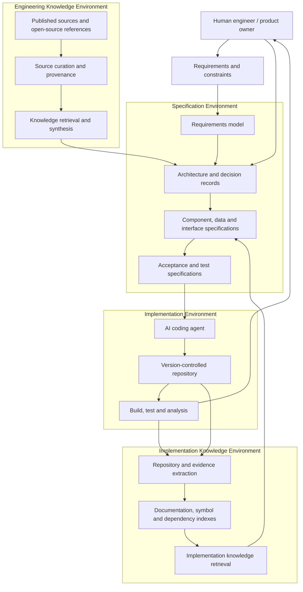

# Architecture overview

## 1. Status and scope

This document defines the conceptual architecture for SpecBook-Agent. It is a target architecture for an evolving experiment, not a claim that the described components have been implemented.

The architecture separates knowledge, specification, implementation, and verification concerns. It does not require a single vendor, model, notebook, database, or orchestration framework.

## 2. Context

The system receives project requirements and constraints, uses curated engineering knowledge to inform design, produces specifications for review, supports implementation through a coding agent, and derives implementation knowledge from the resulting repository and evidence.

## 3. Logical architecture

## 4. Architectural components

### 4.1 Source and knowledge curation

Responsibilities:
- Register sources and their metadata.
- Capture publisher, URL, version, publication or retrieval date where known.
- Record license and reuse constraints.
- Classify sources by engineering domain and applicability.
- Identify stale, conflicting, or low-confidence material.
- Preserve references to original sources.

The ingestion process must not treat external content as trusted instructions. Source content is evidence to evaluate, not authority to override project policy.

### 4.2 Engineering knowledge retrieval

Responsibilities:
- Select relevant material for a project question.
- Retrieve passages, examples, patterns, and source metadata.
- Distinguish source statements from interpretation.
- Surface conflicts, uncertainty, and version mismatches.
- Provide traceable references for engineering decisions.

A NotebookLM notebook can serve as an initial human-facing interface. A future integrated implementation may use document parsing, lexical and semantic retrieval, metadata filters, and code/document indexes.

### 4.3 Requirements and specification management

Responsibilities:
- Capture goals, users, scope, non-goals, constraints, and assumptions.
- Generate structured specification artifacts.
- Maintain stable identifiers and traceability.
- Record architecture decisions and alternatives.
- Define acceptance criteria and verification methods.
- Track approval status and changes.

Specifications should be human-readable and machine-processable where practical. Markdown with YAML front matter is a suitable initial convention; structured schemas can be added as the format stabilizes.

### 4.4 Implementation agent interface

Responsibilities:
- Provide approved specifications and relevant context to a coding agent.
- Identify repository instructions and local conventions.
- Implement bounded changes.
- Produce change summaries and test evidence.
- Request review when requirements or architecture are ambiguous.

The coding agent is replaceable. The interface should not assume a single provider's prompt format or proprietary context mechanism.

### 4.5 Verification

Responsibilities:
- Run project-defined build and test commands.
- Perform static analysis, formatting, dependency, and security checks as appropriate.
- Map test evidence to acceptance criteria.
- Report failures and coverage gaps.
- Preserve reproducible evidence where possible.

A generated test report is evidence of a run, not proof that the system is defect-free.

### 4.6 Implementation knowledge extraction

Responsibilities:
- Inspect repository structure and source code.
- Extract symbols, module boundaries, dependencies, and interfaces.
- Parse schemas, migrations, API definitions, and configuration.
- Collect test and build evidence.
- Generate navigable technical documentation.
- Identify differences between approved specifications and implementation.

Extraction should be incremental where possible and tied to a repository revision. Generated descriptions must identify the commit or revision they describe.

### 4.7 Feedback and reconciliation

Responsibilities:
- Identify specification/implementation drift.
- Route new findings to the relevant requirements, specification, or decision record.
- Update implementation knowledge after code changes.
- Promote reusable patterns only after validation and provenance review.
- Preserve history rather than silently rewriting engineering decisions.

## 5. Data and artifact boundaries

The architecture distinguishes four classes of artifacts:

| Artifact class | Examples | Authority |
|---|---|---|
| External knowledge | Documentation, source code references, standards | Original publisher/source, subject to version and license |
| Project intent | Requirements, constraints, approved specifications, decisions | Version-controlled project artifacts and approval history |
| Implementation evidence | Code, migrations, tests, build output, runtime observations | Repository and actual execution environment |
| Derived knowledge | Summaries, maps, indexes, notebook sources, generated docs | Rebuildable view tied to source revision |

Derived knowledge must carry provenance and freshness information. It must not silently replace source evidence.

## 6. Trust boundaries and security

- Treat imported documents, repositories, issues, and web content as untrusted input.
- Never execute code merely because it appears in a source document.
- Do not send confidential project information to external models or services unless the project owner has explicitly approved that data flow.
- Keep secrets out of prompts, notebooks, logs, generated documentation, and Git.
- Apply access controls to private knowledge and project repositories.
- Record which external services receive project context.
- Review generated dependencies and code before use.

## 7. Initial implementation strategy

The first implementation should validate the lifecycle with ordinary files and existing tools:

1. Curated source register and knowledge documents in Git.
2. NotebookLM used manually for selected source-grounded research.
3. Claude used to draft structured specifications.
4. Human review recorded in version control.
5. Claude Code used to implement a small, bounded system.
6. Automated tests and checks run locally or in CI.
7. A generated implementation dossier created from the repository.
8. The dossier added to a second NotebookLM notebook for exploratory querying.
9. Findings validated against the repository before changes are made.

This proves or challenges the method before introducing custom ingestion services, vector databases, orchestration, or autonomous agents.

## 8. Future extension points

Potential future components include:
- Source registry and ingestion pipeline.
- Document and code parsers.
- Hybrid retrieval and metadata filtering.
- Specification schema validation.
- Repository symbol and dependency graph.
- Agent adapters and task orchestration.
- CI evidence collector.
- Drift and traceability analyzer.
- Knowledge refresh and promotion workflow.

These are extension points, not current capabilities or mandatory technology choices.
