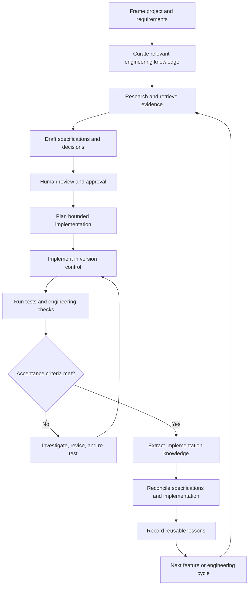

# Engineering workflow

## 1. Purpose

This document describes the end-to-end workflow for applying SpecBook-Agent. The initial workflow is human-orchestrated using existing tools. The same artifacts and controls are intended to support selective automation later.

These are maturity stages of one workflow, not separate products or mutually exclusive modes.

## 2. Lifecycle overview

## 3. Stage 0: Project framing

Capture:
- Problem statement and intended outcomes.
- Users and stakeholders.
- Scope and non-goals.
- Functional needs and quality attributes.
- Technical, organizational, regulatory, and deployment constraints.
- Existing systems and integration boundaries.
- Assumptions, unknowns, and risks.
- Success measures.

Do not begin with a technology choice unless it is already a genuine constraint.

## 4. Stage 1: Knowledge preparation

1. Identify the engineering domains relevant to the project.
2. Select authoritative, version-appropriate sources.
3. Check provenance, licensing, and reuse restrictions.
4. Extract applicable patterns and implementation examples.
5. Record conflicts, limitations, and unresolved questions.
6. Make selected sources available to the research interface.

For the initial experiment, NotebookLM can be used manually. Keep the source register and useful derived notes in the repository.

## 5. Stage 2: Research and design

Use the selected knowledge to investigate design options.

The researcher or architect should:
- Restate the problem and constraints.
- Identify applicable patterns and relevant source evidence.
- Compare alternatives against explicit decision criteria.
- Identify version, operational, security, and licensing concerns.
- Distinguish evidence from inference.
- Record unresolved questions.

Do not select a technology solely because it appears in the knowledge base.

## 6. Stage 3: Specification generation

Produce the minimum complete specification package for the scope:
- Requirements and acceptance criteria.
- Architecture and component boundaries.
- Interface and data contracts.
- Security and operational requirements.
- Test strategy.
- Architecture decision records.
- Traceability links.

Check for contradictions, missing failure behaviour, undefined ownership, ambiguous terms, and untestable requirements.

## 7. Stage 4: Review and approval

Human reviewers confirm:
- Requirements reflect the intended business outcome.
- Constraints and assumptions are visible.
- Architecture trade-offs are understood.
- Security and privacy implications are acceptable.
- Interfaces and data responsibilities are coherent.
- Acceptance criteria are testable.
- Scope is appropriately bounded.

Record approval in version control or the project's agreed review mechanism. An AI-generated document is not approved merely because it is complete-looking.

## 8. Stage 5: Implementation planning

Break approved specifications into small, verifiable work items.

Each work item should identify:
- Scope and intended outcome.
- Relevant specification IDs.
- Expected files or components, where known.
- Dependencies and prerequisites.
- Acceptance criteria.
- Tests and checks.
- Risks and rollback considerations.

A coding agent should inspect the repository and local instructions before changing code.

## 9. Stage 6: Implementation

The coding agent:
1. Reads applicable instructions and specifications.
2. Inspects existing implementation and conventions.
3. Proposes a bounded plan for non-trivial changes.
4. Implements the change.
5. Adds or updates tests.
6. Reports files changed, design choices, and known limitations.

Avoid large, opaque generation steps. Keep changes reviewable and use branches or commits according to project policy.

## 10. Stage 7: Verification

Run the checks relevant to the change:
- Formatting and linting.
- Type checking and static analysis.
- Unit and integration tests.
- Contract and end-to-end tests.
- Security and dependency checks.
- Build and migration validation.
- Performance checks where required.

Capture commands, environment, revision, results, and known gaps. If a check was not run, state that explicitly.

## 11. Stage 8: Implementation knowledge refresh

Refresh the implementation knowledge from the actual repository and available execution evidence.

At minimum, update relevant:
- Module and component descriptions.
- API and data contracts.
- Dependency and integration maps.
- Test and verification records.
- Architecture decisions.
- Known limitations and technical debt.

Tie generated documentation to the commit or revision it describes. Do not infer runtime behaviour from static code alone.

## 12. Stage 9: Reconciliation and feedback

Compare approved specifications with actual implementation and test evidence.

Classify findings:
- Matches approved specification.
- Approved specification changed.
- Implementation deviation requiring correction or approval.
- Documentation or index stale.
- Evidence insufficient.
- Requirement or design gap discovered.

Promote reusable lessons into the Engineering Knowledge Base only after reviewing context, evidence, provenance, and applicability. A one-project workaround should not become a universal pattern.

## 13. Initial tool choreography

The first demonstration can use:
- NotebookLM for selected source-grounded research.
- Claude for analysis and drafting specifications.
- Human review through Git diffs and document review.
- Claude Code for repository implementation.
- Existing test and analysis tools for verification.
- Scripts or manual extraction for implementation documentation.
- A second NotebookLM notebook for querying selected implementation documentation.

The workflow must remain usable if any one of these products is replaced.

## 14. Automation progression

Automate a step only after its inputs, outputs, failure cases, and verification method are understood.

A sensible progression is:
1. Templates and checklists.
2. Repeatable scripts for source and repository extraction.
3. Schema and traceability validation.
4. Retrieval and indexing services.
5. Agent adapters for bounded tasks.
6. Orchestration with approval gates.
7. Automated drift detection and knowledge refresh.

Do not automate approval or release decisions merely to remove a human from the loop.
